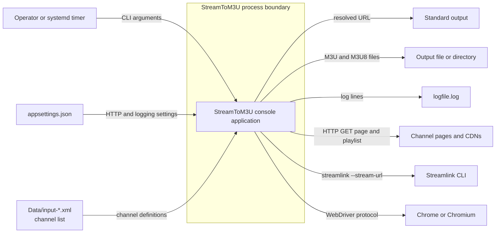
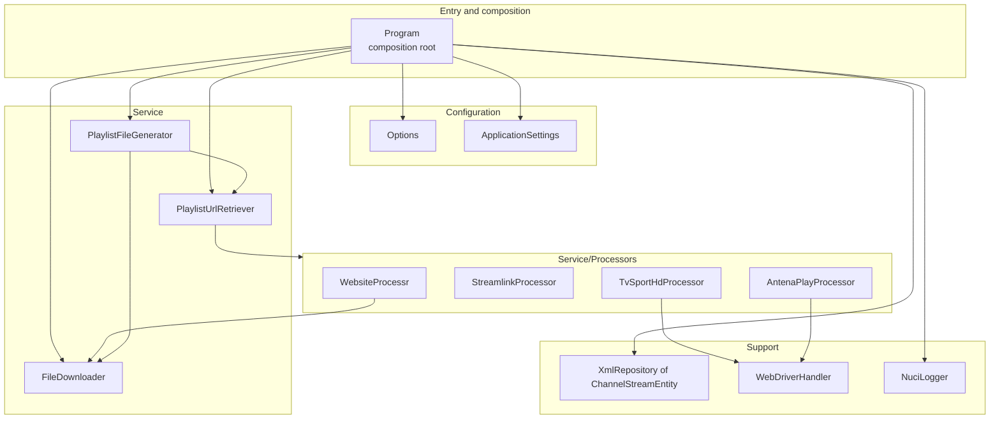
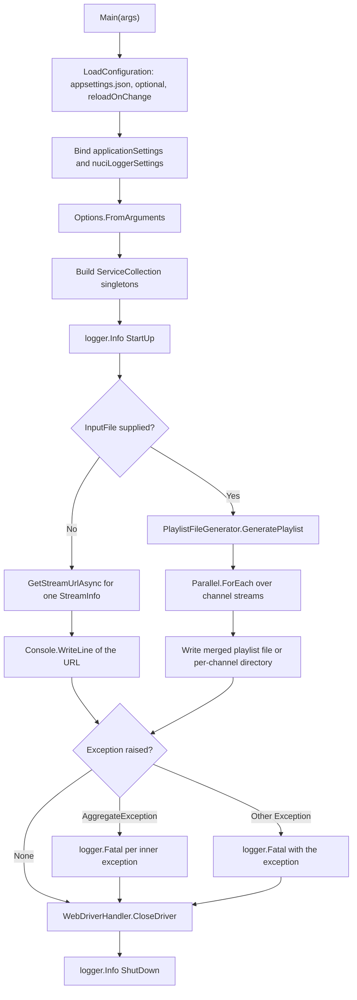
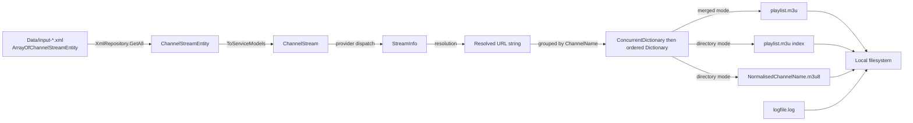
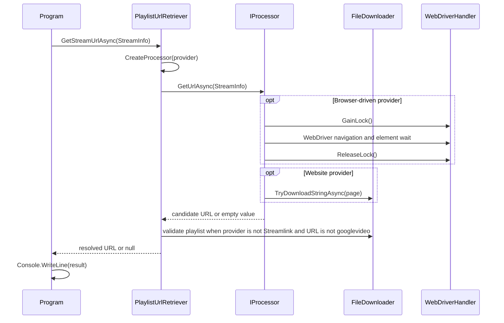
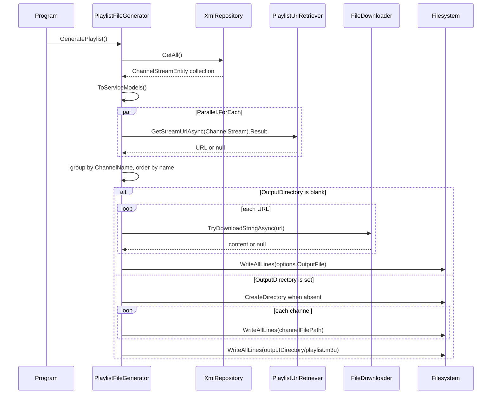
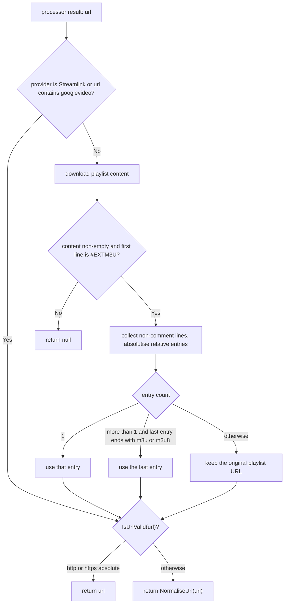
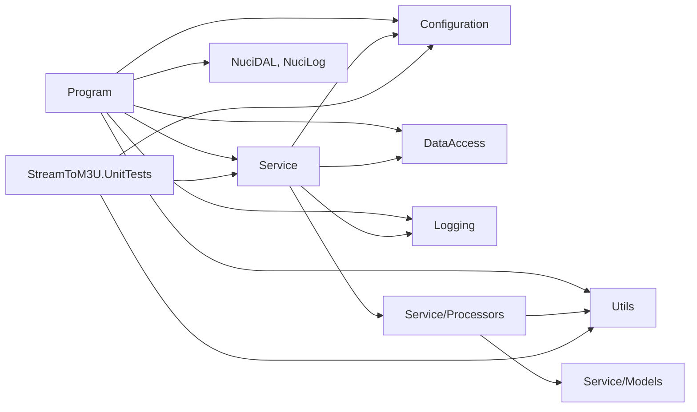

# StreamToM3U Architecture

This document describes the current architecture of the StreamToM3U console application: its system boundary, component responsibilities, runtime procedure, data flow, dependency rules, operational constraints, and extension points. It records the implementation as it exists in this repository and does not define a target architecture.

## 📑 Table of Contents

- [Purpose](#-purpose)
- [System Context](#-system-context)
- [Architectural Style](#-architectural-style)
- [Runtime Process](#-runtime-process)
- [Components](#-components)
- [Architectural Areas](#-architectural-areas)
  - [Configuration](#configuration)
  - [Data Access](#data-access)
  - [Logging](#logging)
  - [Service](#service)
  - [Processors](#processors)
  - [Utilities](#utilities)
  - [Data](#data)
  - [Unit Tests](#unit-tests)
- [Data Architecture](#-data-architecture)
- [Interfaces and Integrations](#-interfaces-and-integrations)
- [Key Processes](#-key-processes)
  - [Single Stream Resolution](#single-stream-resolution)
  - [Batch Playlist Generation](#batch-playlist-generation)
  - [Playlist URL Resolution](#playlist-url-resolution)
- [Channel Grouping and Naming](#-channel-grouping-and-naming)
- [Cross-Cutting Concerns](#-cross-cutting-concerns)
  - [Security and Privacy](#security-and-privacy)
  - [Error Handling](#error-handling)
  - [Observability](#observability)
  - [Configuration](#configuration-1)
  - [Concurrency and Resource Use](#concurrency-and-resource-use)
- [Dependency Direction and Rules](#-dependency-direction-and-rules)
- [External Dependencies](#-external-dependencies)
- [Deployment and Operations](#-deployment-and-operations)
- [Compatibility Contracts](#-compatibility-contracts)
- [Testing and Verification](#-testing-and-verification)
- [Design Constraints](#-design-constraints)
- [Extension Points](#-extension-points)
  - [Adding a Stream Provider](#adding-a-stream-provider)
  - [Replacing the Input Source](#replacing-the-input-source)
  - [Changing Playlist Output](#changing-playlist-output)
- [Architecture Decisions](#-architecture-decisions)
- [Source Map](#-source-map)
- [Related Documentation](#-related-documentation)

## 🎯 Purpose

StreamToM3U is a stateless, single-process command-line tool. Its principal responsibility is to convert channel definitions into playable M3U playlist data: either by resolving one live stream URL and writing it to standard output, or by resolving every channel declared in an XML file and writing merged or per-channel playlist files.

The architectural scope covers process composition, provider dispatch, URL resolution and validation, playlist generation, logging, and the shared browser automation handle. Installation, usage, and configuration guidance live in [README.md](./README.md) and are not duplicated here. Recording these boundaries matters because the tool's behaviour depends heavily on third-party surfaces — channel websites, CDNs, Streamlink, and a Chromium-based browser — that are outside its control.

## 🌐 System Context



The principal external boundaries are:
- **Operator or scheduler:** Supplies command-line arguments, invokes the process, and consumes either the printed URL or the generated playlist files.
- **Channel pages and CDNs:** Untrusted HTTP content read by `FileDownloader`; the tool depends on their HTML structure and playlist format, and their availability directly determines resolution success.
- **Streamlink CLI:** An external executable resolved from `PATH`; the tool delegates stream selection to it and consumes its standard output.
- **Chrome or Chromium:** A local browser driven through Selenium by the TVSportHD and AntenaPlay processors; it is a hard runtime prerequisite for those providers.
- **TVSportHD and AntenaPlay websites:** Remote services whose pages, iframes, and account registration flows are automated; the tool holds no credentials and creates disposable registrations only during execution.
- **Local filesystem:** Holds `appsettings.json`, the XML channel list, the log file, and generated playlists; it is the only persistence surface.

## 🏗️ Architectural Style

The application is a layered console pipeline with a provider strategy. A single composition root wires singletons through `Microsoft.Extensions.DependencyInjection`; `Service` holds orchestration and interfaces; `Service/Processors` holds interchangeable provider implementations selected by a `switch` over the `StreamProvider` enumeration; `DataAccess` holds the XML-backed entity; `Utils` holds the process-wide browser handle.



The principal architecture boundaries are:
- **Entry and composition (`Program`):** Owns configuration loading, container construction, top-level exception handling, and browser shutdown. It is the only component permitted to decide process termination.
- **Configuration:** Owns settings binding and command-line parsing, and exposes immutable-by-convention singletons to the rest of the composition.
- **Service:** Owns orchestration (batch generation), URL resolution policy, and HTTP access. It may depend on processors, models, configuration, logging, and data-access types.
- **Processors:** Own provider-specific extraction only. They may depend on their own provider surface and on `WebDriverHandler`, and must not write files or log.
- **Utilities:** Own process-wide resources (`WebDriverHandler`) and expose them without knowledge of callers.
- **Unit tests:** Depend on the application project by project reference and never on external services.

## 🔄 Runtime Process



The principal runtime sequence is:
1. `Program.Main` loads `appsettings.json` through `ConfigurationBuilder` (the file is optional and reload-on-change is enabled), then binds `ApplicationSettings` and `NuciLoggerSettings` by section name.
2. `Options.FromArguments(args)` maps option aliases to strongly typed properties and selects the provider from the presence of provider flags.
3. A `ServiceCollection` is built with singleton registrations for settings, options, `IFileRepository<ChannelStreamEntity>` (a NuciDAL `XmlRepository` over `options.InputFile`), `IFileDownloader`, `IPlaylistUrlRetriever`, `IPlaylistFileGenerator`, and `ILogger`.
4. With no input file, the tool resolves one stream and prints the URL to standard output; with an input file, it delegates batch generation to `IPlaylistFileGenerator`.
5. Any exception is logged at `Fatal` level; `WebDriverHandler.CloseDriver()` always runs, and a final `ShutDown` log line is written. The process returns the default exit code in every case.

## 🧩 Components

| Component | Responsibility | Principal Dependencies | Lifetime or Ownership |
|-----------|----------------|------------------------|-----------------------|
| `Program` | Composition root: configuration binding, container construction, mode selection, exception handling, browser shutdown | Configuration, DI container, NuciLog | Process lifetime |
| `Options` | Command-line alias parsing, provider selection, default `playlist.m3u` output file | None | Singleton instance created at startup |
| `ApplicationSettings`, `NuciLoggerSettings` | Bound configuration values for HTTP access and logging | `Microsoft.Extensions.Configuration` | Singleton, bound once |
| `IFileRepository<ChannelStreamEntity>` | Reads the XML channel list | `NuciDAL.Repositories.XmlRepository` | Singleton, created from `options.InputFile` |
| `IFileDownloader` / `FileDownloader` | HTTP text download, URL normalisation, download logging | `HttpClient`, `ILogger` | Singleton holding one `HttpClient` |
| `IPlaylistUrlRetriever` / `PlaylistUrlRetriever` | Provider dispatch, playlist validation, stream-entry selection | `IFileDownloader`, processors | Singleton |
| `IProcessor` implementations | Extract a playlist or stream URL for one provider | `IFileDownloader`, `WebDriverHandler`, external CLI | Instantiated per resolution call by `PlaylistUrlRetriever` |
| `IPlaylistFileGenerator` / `PlaylistFileGenerator` | Batch resolution, channel grouping, playlist file and directory writing | Repository, retriever, downloader, `Options`, `ILogger` | Singleton |
| `ChannelStreamMapping` | Maps `ChannelStreamEntity` to `ChannelStream` and parses the provider name | `Enum.Parse<StreamProvider>` | Static |
| `WebDriverHandler` | Lazily creates one headless `ChromeDriver`, serialises access, quits the driver at shutdown | Selenium `ChromeDriver` | Process-wide static state |
| `ILogger` (`NuciLogger`) | Structured operation logging to console and file | `NuciLogSettings` | Singleton |

## 🗂️ Architectural Areas

### Configuration

Paths:
- `StreamToM3U/Configuration/Options.cs`
- `StreamToM3U/Configuration/ApplicationSettings.cs`
- `StreamToM3U/Configuration/StreamProvider.cs`

Responsibilities:
- Translate command-line aliases into `Options` with a default output file and a default `Website` provider.
- Hold the HTTP request timeout and user agent values.
- Define the provider enumeration consumed by dispatch and XML parsing.

Boundary rules:
- No dependency on `Service`, processors, or data-access types.
- `Options.FromArguments` is the only supported parsing entry point; option aliases are grouped in static arrays to keep the public CLI contract in one place.

### Data Access

Paths:
- `StreamToM3U/DataAccess/DataObjects/ChannelStreamEntity.cs`

Responsibilities:
- Declare the XML-serialisable channel record derived from `NuciDAL.DataObjects.EntityBase`.

Boundary rules:
- Data objects must not reference service models; mapping is performed in `StreamToM3U/Service/Mapping`.
- Field names are fixed by the XML input format and must not be renamed without a migration of `StreamToM3U/Data/input-*.xml`.

### Logging

Paths:
- `StreamToM3U/Logging/MyOperation.cs`
- `StreamToM3U/Logging/MyLogInfoKey.cs`

Responsibilities:
- Define the application-specific operations (`FileDownload`, `ChannelStreamFetching`) and log information keys (`ChannelStreamId`, `Url`).

Boundary rules:
- Only extend `Operation` and `LogInfoKey`; callers use `NuciLog.Core` abstractions rather than concrete implementations.

### Service

Paths:
- `StreamToM3U/Service/IFileDownloader.cs`
- `StreamToM3U/Service/FileDownloader.cs`
- `StreamToM3U/Service/IPlaylistUrlRetriever.cs`
- `StreamToM3U/Service/PlaylistUrlRetriever.cs`
- `StreamToM3U/Service/IPlaylistFileGenerator.cs`
- `StreamToM3U/Service/PlaylistFileGenerator.cs`
- `StreamToM3U/Service/Mapping/ChannelStreamMapping.cs`
- `StreamToM3U/Service/Models/ChannelStream.cs`
- `StreamToM3U/Service/Models/StreamInfo.cs`

Responsibilities:
- Own all orchestration, URL resolution policy, HTTP access, and output generation.
- Provide the contracts consumed by `Program` and by the unit tests.

Boundary rules:
- Processors must only be referenced through `IProcessor`; provider construction is confined to `PlaylistUrlRetriever.CreateProcessor`.
- File writing is confined to `PlaylistFileGenerator`; no other component writes playlists.

### Processors

Paths:
- `StreamToM3U/Service/Processors/IProcessor.cs`
- `StreamToM3U/Service/Processors/WebsiteProcessor.cs`
- `StreamToM3U/Service/Processors/StreamlinkProcessor.cs`
- `StreamToM3U/Service/Processors/TvSportHdProcessor.cs`
- `StreamToM3U/Service/Processors/AntenaPlayProcessor.cs`

Responsibilities:
- Extract a URL from page HTML, from the Streamlink CLI, or from a browser-driven page.
- Report provider-specific failure by returning an empty or invalid value, or by throwing for the caller to translate.

Boundary rules:
- Processors must not log, must not write files, and must not know about playlist generation.
- Only the browser-driven processors may acquire `WebDriverHandler` locks, and each acquisition must be paired with `ReleaseLock` on the success path.

### Utilities

Paths:
- `StreamToM3U/Utils/WebDriverHandler.cs`

Responsibilities:
- Lazily create one headless `ChromeDriver` with image loading and notifications disabled, and expose it as a lazily initialised static property.
- Serialise browser-driven providers through `GainLock` and `ReleaseLock`.

Boundary rules:
- No dependency on configuration, service, or processor types.
- All Selenium-specific configuration stays here; processors consume `NuciWeb.Automation` abstractions.

### Data

Paths:
- `StreamToM3U/Data/input-ro.xml`
- `StreamToM3U/Data/input-md.xml`
- `StreamToM3U/Data/input-int.xml`

Responsibilities:
- Provide the sample channel lists used in batch mode.

Boundary rules:
- These files are content, not code; they must remain valid `ArrayOfChannelStreamEntity` documents.

### Unit Tests

Paths:
- `StreamToM3U.UnitTests/Service`
- `StreamToM3U.UnitTests/Configuration`
- `StreamToM3U.UnitTests/Logging`
- `StreamToM3U.UnitTests/Utils`
- `StreamToM3U.UnitTests/TestDoubles`

Responsibilities:
- Verify resolution, generation, configuration defaults, logging contracts, and the browser lock semantics with Moq doubles.
- Provide `LoopbackHttpServer`, a loopback `TcpListener` HTTP double, for downloader tests.

Boundary rules:
- Tests may reference the application project; the application project must never reference the test project.
- Tests must not require network access, a browser, or Streamlink.

## 💾 Data Architecture



| Data or Store | Owner | Representation and Storage | Lifecycle or Consistency |
|---------------|-------|----------------------------|--------------------------|
| `ChannelStreamEntity` | `NuciDAL.Repositories.XmlRepository` | XML elements in `Data/input-*.xml`; `Provider` is a free-form string | Read once per run through `GetAll()`; no writes |
| `ChannelStream` | `ChannelStreamMapping` | In-memory service model with a parsed `StreamProvider` | Created per batch run; discarded at exit |
| `StreamInfo` | `Program` and `PlaylistUrlRetriever` | In-memory request model for one resolution | Per resolution call |
| Grouped channel URLs | `PlaylistFileGenerator` | `ConcurrentDictionary<string, List<string>>` keyed by `ChannelName`, then flattened into an ordered `Dictionary` | Populated in parallel, ordered by channel name before writing |
| `playlist.m3u` | `PlaylistFileGenerator` | `#EXTM3U` text file at `options.OutputFile`, or the index file inside `options.OutputDirectory` | Overwritten on every run; no merge with prior content |
| Per-channel `.m3u8` files | `PlaylistFileGenerator` | `#EXTM3U` plus one `#EXT-X-STREAM-INF:BANDWIDTH=873` block per stream | Overwritten on every run; the output directory is created when absent |
| `logfile.log` | `NuciLogger` | Append-style text log at `nuciLoggerSettings.logFilePath` | Controlled by `minimumLevel` and `isFileOutputEnabled`; no rotation implemented in this repository |

## 🔌 Interfaces and Integrations

| Interface or Integration | Direction | Contract | Owner | Failure Semantics |
|--------------------------|-----------|----------|-------|-------------------|
| Command line | Inbound | Aliased flags in `Options` (`--input`, `--output-file`, `--output-dir`, `--channel`, `--title`, `--url`, `--baseurl`, provider flags); `-x=value` and `-x value` forms are both accepted | `Options` | Unknown flags are ignored; a missing value yields an empty string; provider flags fall back to `Website` |
| Standard output | Outbound | Exactly one resolved URL when no input file is supplied | `Program` | A `null` URL is printed as an empty line; failures are logged, not reported by exit code |
| XML channel list | Inbound | `ArrayOfChannelStreamEntity` with `Id`, `ChannelName`, `Provider`, optional `ChannelId`, `Title`, `Url`, `StreamBaseUrl` | `XmlRepository<ChannelStreamEntity>` | An unparsable `Provider` string raises `ArgumentException` inside the parallel loop, surfacing as `AggregateException` |
| `appsettings.json` | Inbound | `applicationSettings.requestTimeout`, `applicationSettings.userAgent`, `nuciLoggerSettings.*` | `Program` binding | Missing file keeps `NuciLog` defaults and a zero timeout, which makes `HttpClient` construction fail |
| HTTP GET | Outbound | Plain `GET` with the configured user agent; response read fully as UTF-8 | `FileDownloader` | Every exception is swallowed and `null` is returned after a `Verbose` failure log |
| Streamlink CLI | Outbound | `streamlink --stream-url <url> best`, standard output redirected | `StreamlinkProcessor` | Empty or non-`http` output becomes an empty string; a missing executable surfaces as `AggregateException` |
| WebDriver (Selenium) | Outbound | W3C WebDriver commands to a local `ChromeDriver` | `WebDriverHandler` | Element waits throw; `PlaylistUrlRetriever` converts processor exceptions to `null` |
| TVSportHD website | Outbound | `http://www.tv-sport-hd.com/channel/tvs.php?ch=<ChannelId>`, iframe `thatframe`, `source` element `src` | `TvSportHdProcessor` | Any DOM mismatch becomes a failed resolution |
| AntenaPlay website | Outbound | `https://antenaplay.ro` registration plus `/live/<ChannelId>`; `streamURL: "..."` regex over page source | `AntenaPlayProcessor` | Missing SMS validation or missing stream pattern becomes a failed resolution |
| `ILogger` | Outbound | `NuciLog` operations and `LogInfo` key/value pairs | `Program`, `FileDownloader`, `PlaylistFileGenerator` | A logging failure is not caught by the application |

## 🔀 Key Processes

### Single Stream Resolution



The ordering matters because provider exceptions are translated to `null` before validation, and validation is skipped for Streamlink and `googlevideo` URLs. The process is single-shot: there is no retry, and the printed result may be empty.

### Batch Playlist Generation



Channels whose URL resolves to `null` or whitespace are logged at `Debug`/`Failure` and omitted from the playlist. In merged mode, a URL is additionally dropped when its content cannot be downloaded or is empty; the downloaded content itself is discarded, so the extra request is a reachability check. In directory mode no such check is performed.

### Playlist URL Resolution



Relative playlist entries are rewritten by replacing the trailing `*.m3u`/`*.m3u8` segment of the playlist URL with the entry. When the processor returns `null` and validation is required, or when the fallback normalisation receives `null`, the method raises `NullReferenceException`; this behaviour is pinned by the unit tests.

## ⚙️ Channel Grouping and Naming

Channel identity in the output is the `ChannelName` field, not the `Id` field. All resolved URLs sharing a `ChannelName` are emitted under that name, which is how a single logical channel can carry multiple streams from separate XML entries. Ordering is alphabetical by `ChannelName` through `OrderBy` before writing.

Directory mode derives each file name from the channel name: the text before the first `:` is discarded, diacritics are removed, punctuation is removed, spaces are removed, and `.m3u8` is appended, producing `<Channel>.m3u8`. Two channels that normalise to the same name therefore share one output file, and the later write wins; the algorithm is a compatibility contract because consumers reference these names in the index playlist.

Merged mode writes `#EXTINF:-1,<ChannelName>` followed by the raw URL. Directory mode writes the index with `#EXTINF:-1,<ChannelName>` followed by an absolute channel file path when `--url` is absent, or `<baseUrl>/<fileName>` when it is present, and writes `#EXT-X-STREAM-INF:BANDWIDTH=873` before every stream in each channel file. The bandwidth value is a fixed literal and conveys no measured information.

## 🧵 Cross-Cutting Concerns

### Security and Privacy

The tool has no authentication model, no stored credentials, and no inbound network surface. Trust boundaries are the channel pages and playlists it fetches: HTML is parsed with regular expressions over untrusted content, and downloaded playlist content is never executed. URLs reach the filesystem unescaped through `File.WriteAllLines`, and per-channel file names are sanitised only by diacritic, punctuation, and space removal rather than by a allow-list of characters.

The AntenaPlay provider automates a registration form using randomly generated ten-character strings as e-mail local part, password, first name, and last name, always with a `@gmail.com` domain, and logs out at the end of the attempt. These values are ephemeral and are not persisted by the application. Diagnostics write resolved stream URLs to `logfile.log`, so the log file is treated as sensitive: it can disclose the channels consumed and any tokens embedded in playback URLs. Secrets are never read from environment variables, and no configuration value in this repository is confidential.

### Error Handling

Failures are handled at three levels:
- **Processor level:** `PlaylistUrlRetriever.FindStreamUrl` catches every processor exception and returns `null`, so a provider outage degrades to a skipped channel rather than a failed run.
- **Download level:** `FileDownloader.TryDownloadStringAsync` catches every exception, logs it at `Verbose`, and returns `null`; callers translate `null` into a skipped entry or a failed resolution.
- **Process level:** `Program` catches `AggregateException` (unwrapping each inner exception into a separate `Fatal` record) and any other `Exception`, logs it, and continues to shutdown.

There is no retry, no circuit breaking, and no non-zero exit code on failure. A batch run in which every channel fails exits successfully and writes a playlist containing only `#EXTM3U`. The only unhandled degradation path is a `NullReferenceException` raised inside `PlaylistUrlRetriever` when processor output is `null` while validation is still required; inside `Parallel.ForEach` this surfaces as `AggregateException`.

### Observability

`NuciLogger` receives structured records built from `MyOperation` and `MyLogInfoKey` values and writes them to the console and to `nuciLoggerSettings.logFilePath`. Emitted signals are: `StartUp` and `ShutDown` at `Info`; `ChannelStreamFetching` at `Info` (`Started`) and `Debug` (`Success`/`Failure`) with the channel stream identifier; `FileDownload` at `Debug` (`Started`), `Verbose` (`Success`), and `Verbose` (`Failure`) with the normalised URL. Exceptions are logged at `Fatal`.

There are no metrics, traces, or health endpoints, and no correlation identifier spanning a batch run. Because per-channel outcomes are logged at `Debug` while the default `minimumLevel` is `Info`, successful and failed resolutions are invisible at default settings; only the startup and shutdown records appear unless the level is lowered.

### Configuration

| Configuration Area | Source | Responsibility | Supersede or Secret Policy |
|--------------------|--------|----------------|---------------------------|
| HTTP access | `appsettings.json` → `applicationSettings.requestTimeout`, `applicationSettings.userAgent` | `HttpClient` timeout and `User-Agent` header applied to every download | Bound once at startup; no environment or CLI supersede exists |
| Logging | `appsettings.json` → `nuciLoggerSettings.logFilePath`, `minimumLevel`, `isFileOutputEnabled` | Destination, verbosity, and file output of diagnostics | Bound once at startup; no secret values |
| Run mode and output | Command line → `Options` | Input file, output file, output directory, provider, channel and URL parameters | CLI always wins because it is the only source; no configuration file counterpart |
| Channel definitions | XML input files | Channel names, providers, source URLs, and optional base URLs | File contents are authoritative; the provider string must parse into `StreamProvider` |

`appsettings.json` is loaded with optional and reload-on-change flags, but the bound objects are plain singletons with no `IOptionsMonitor`, so reloading has no effect on behaviour. A missing file leaves `requestTimeout` at `0`, which makes `HttpClient.Timeout` assignment throw.

### Concurrency and Resource Use

Batch resolution runs inside `Parallel.ForEach` over the channel collection. Each iteration blocks on `Task.Result` against an asynchronous resolution, so parallelism is expressed by thread-pool workers waiting on I/O rather than by asynchronous composition. Shared state is limited to a `ConcurrentDictionary` for the results, a `TryAdd` guarded by a `ContainsKey` check, and a `List<string>` appended through that dictionary; the per-list mutation is not itself synchronised.

Browser-driven providers cannot run concurrently because all of them share one static `ChromeDriver`. `WebDriverHandler.GainLock` spins on a `bool` guarded by a `Lock` with a one-second `Thread.Sleep`, and `ReleaseLock` writes the flag outside the lock. Concurrency is therefore serialised by polling, and a processor that throws before releasing the flag leaves the flag set, blocking later browser-driven iterations. `HttpClient` is a single instance inside the singleton downloader and is reused across calls, which is correct; `Program` always calls `WebDriverHandler.CloseDriver()` at shutdown so the browser process does not survive the run.

## 🧭 Dependency Direction and Rules



The principal dependency rules are:
- Dependencies point from entry and orchestration inward: `Program` → `Service` → `Processors`, and every layer may use `Configuration`, `Logging`, and `Service/Models`.
- `Configuration`, `Logging`, and `Service/Models` are leaf areas with no project-internal dependencies.
- `DataAccess` depends on `NuciDAL` only; conversion to `ChannelStream` happens in `Service/Mapping`, so data objects never leak into processors.
- Processors must not depend on `PlaylistFileGenerator`, `PlaylistUrlRetriever`, `Options`, or any file-writing code.
- `Utils` must not depend on `Service`, `Configuration`, or `DataAccess`.
- The application project must never reference `StreamToM3U.UnitTests`.

## 📦 External Dependencies

| Dependency | Responsibility | Integration Boundary | Architectural Consequence |
|------------|----------------|----------------------|---------------------------|
| `NuciDAL` | XML-backed `IFileRepository<T>` and `EntityBase` | `Program` registration, `PlaylistFileGenerator`, `ChannelStreamEntity` | The input format is defined by XML serialisation of the entity type; property renames break existing files |
| `NuciLog` / `NuciLog.Core` | `ILogger`, `Operation`, `OperationStatus`, `LogInfoKey` | All logging call sites | Log vocabulary is extended only through `MyOperation` and `MyLogInfoKey`; replacing the logger requires changing the registration only |
| `NuciWeb`, `NuciWeb.Automation`, `NuciWeb.Automation.Selenium` | Browser automation abstractions and `IWebProcessor` | `TvSportHdProcessor`, `AntenaPlayProcessor` | Provider automation is written against NuciWeb selectors, not raw Selenium, except for iframe switching |
| `Selenium.WebDriver` (transitive) | `ChromeDriver`, `IWebDriver`, `By` | `WebDriverHandler`, processors | Couples runtime prerequisites to a local Chrome or Chromium installation |
| `Microsoft.Extensions.DependencyInjection` | Composition root | `Program` | All services are singletons; there is no per-request scope |
| `Microsoft.Extensions.Configuration.*` | JSON configuration binding | `Program`, settings classes | Section names and property names form the configuration contract |
| `NuciCLI`, `NuciExtensions` | Command-line helpers and string utilities (`RemoveDiacritics`, `RemovePunctuation`, `ToSentenceCase`, `GetRandomElement`) | `Options` adjacent code, `PlaylistFileGenerator`, `AntenaPlayProcessor` | String normalisation behaviour for channel file names is delegated to these extensions |
| Streamlink executable | Best-stream selection for Streamlink provider | `StreamlinkProcessor` | External process dependency resolved from `PATH` |
| TVSportHD and AntenaPlay websites | Channel page and stream URL sources | Browser-driven processors | External page structure changes break resolution without any compile-time signal |

## 🚀 Deployment and Operations

StreamToM3U is distributed as a self-contained archive per runtime identifier through GitHub Releases; the `github-release.yml` workflow derives the .NET version from `StreamToM3U/StreamToM3U.csproj`, invokes the external .NET release helper, and attaches archives for `linux-arm`, `linux-arm64`, `linux-x64`, `osx-arm64`, `osx-x64`, `win-arm64`, and `win-x64`. The primary documented operational pattern is a systemd service template plus timer that regenerates one playlist set per channel file family and writes it into a served directory.

| Concern | Current Design | Architectural Consequence |
|---------|----------------|---------------------------|
| Process topology | One short-lived process per invocation; no daemon, no server, no listening socket | Operators control cadence externally, typically with a systemd timer |
| Host prerequisites | Chrome or Chromium for TVSportHD and AntenaPlay; Streamlink on `PATH` for the Streamlink provider | Providers fail silently when prerequisites are missing; only the log records the failure |
| Persistent state | `appsettings.json`, XML input, `logfile.log`, generated playlist files | The working directory must contain `appsettings.json`; a missing file prevents downloads |
| Output location | Merged file at `options.OutputFile`, or an index plus per-channel files in `options.OutputDirectory` | A served directory must be writable by the service user and reachable over HTTP when `--url` is supplied |
| Scheduling | External timer, documented as `stream-to-m3u.timer` with `OnUnitActiveSec=40min` | Runs are independent; no incremental reuse or conditional regeneration exists |
| Resource limits | Docs recommend `MemoryMax=256M` per service instance | Each browser-driven run starts Chromium and consumes memory beyond the .NET footprint |
| Availability and recovery | No retry, no checkpoint, no rollback | A partial or empty playlist can replace a previously valid one; operators must retain prior output externally |
| Shutdown | `WebDriverHandler.CloseDriver()` in a `finally` block | Browser processes do not leak across normal runs, including failed ones |
| Operator-visible outputs | Standard output (single-URL mode), playlist files, `logfile.log` | Exit codes carry no information; success must be inferred from files and logs |

## 🛡️ Compatibility Contracts

| Contract | Owner | Invariant | Verification | Change Policy |
|----------|-------|-----------|--------------|---------------|
| XML input schema | `ChannelStreamEntity` | Element names `ArrayOfChannelStreamEntity` and `ChannelStreamEntity` with fields `Id`, `ChannelName`, `Provider`, `ChannelId`, `Title`, `Url`, `StreamBaseUrl` | Exercised indirectly through repository consumption in batch tests and the shipped `Data/input-*.xml` files | Existing files in the wild require a compatibility path before any rename |
| Provider name values | `ChannelStreamMapping` | `Provider` must parse case-insensitively into `StreamProvider` (`Website`, `TvSportHd`, `AntenaPlay`, `Streamlink`) | Presence of the enumeration and `Enum.Parse` call; invalid values raise `AggregateException` | New providers must be added to the enumeration and the dispatch switch together |
| Command-line aliases | `Options` | Documented aliases and defaults, including `playlist.m3u` as the default output file and `Website` as the default provider | `OptionsTests` and README option table | Aliases may be added; existing aliases must not be repurposed |
| M3U output markers | `PlaylistFileGenerator` | `#EXTM3U` header, `#EXTINF:-1,<name>` entries, `#EXT-X-STREAM-INF:BANDWIDTH=873` lines, alphabetical channel order | `PlaylistFileGeneratorTests` | Consumers parse these markers; format changes require a migration note |
| Channel file naming | `PlaylistFileGenerator` | Channel name after the first `:` with diacritics, punctuation, and spaces removed, suffixed with `.m3u8` | `PlaylistFileGeneratorTests` naming cases | Renaming invalidates published index references |
| Index entry form | `PlaylistFileGenerator` | Absolute channel file path without `--url`; `<baseUrl>/<fileName>` with `--url` | `PlaylistFileGeneratorTests` base-URL cases | Consumers rely on the prefix form; changes require republishing all indexes |
| Single-URL standard output | `Program` | Exactly one URL written to standard output when no input file is supplied | Manual verification only | Scripted consumers parse this line; additional output must not be introduced |
| Configuration keys | `ApplicationSettings`, `NuciLoggerSettings` | Section names and property names as bound by `ConfigurationBuilder` | `appsettings.json` in the repository | Keys may be added with defaults; renames require a migration path |
| Playlist validation rule | `PlaylistUrlRetriever` | First line must begin with `#EXTM3U`; the single entry, or the last entry ending in `m3u`/`m3u8`, wins | `PlaylistUrlRetrieverTests` | Selection policy changes alter published stream URLs |

## ✅ Testing and Verification

`StreamToM3U.UnitTests` is an NUnit 4 fixture set using Moq doubles, covering `FileDownloader` (construction guards, unresolvable URLs, logging of started and failed downloads), `PlaylistUrlRetriever` (absolute and relative playlist references, base URL handling, Google Video bypass, entry selection), `WebsiteProcessr` (quoting preference and base URL joining), `PlaylistFileGenerator` (empty input, alphabetical ordering, multiple streams, skipped channels, directory creation, naming, index forms, merged mode), `Options` and `StreamProvider` defaults, `MyOperation` and `MyLogInfoKey` values, and `WebDriverHandler` lock semantics.

`LoopbackHttpServer` binds `TcpListener` to `127.0.0.1` on an ephemeral port and serves a canned status and body, which keeps downloader tests hermetic without patching `HttpClient`. Request capture proves that invalid URLs are never transmitted.

Execute the principal automated verification with:

```bash
dotnet test
```

```bash
dotnet build
```

Material coverage gaps: `Program` orchestration, `StreamlinkProcessor`, `TvSportHdProcessor`, and `AntenaPlayProcessor` have no tests and require Streamlink or a browser to exercise; no integration or end-to-end test drives a real provider; systemd deployment artefacts are not validated by any automated check.

## ⚠️ Design Constraints

- **Static browser singleton:** `WebDriverHandler` stores one `ChromeDriver` in static state with a boolean lock, so browser-driven providers are strictly sequential and a missing `ReleaseLock` stalls subsequent channels.
- **Synchronous-over-asynchronous:** `Parallel.ForEach` and `.Result` block on asynchronous resolution, so the parallelism is thread blocking rather than true asynchrony, and exceptions surface as `AggregateException` rather than their original types.
- **Silent failure policy:** Failed channels are skipped and the process still exits successfully, so batch success cannot be inferred from the exit code.
- **Content probe cost:** Merged mode downloads each resolved playlist only to confirm reachability and discards the body, adding one HTTP round-trip per stream while directory mode performs none.
- **Fixed bandwidth marker:** `#EXT-X-STREAM-INF:BANDWIDTH=873` is a literal, so playlist consumers cannot use it to compare variants.
- **No persistence or state:** Every run resolves from scratch; there is no cache, no delta detection, and no retry of previously failing channels.
- **Configuration reload is inert:** `reloadOnChange` is enabled but the bound singleton settings are not observed.
- **Log-based diagnosis only:** Per-channel outcomes are logged below the default minimum level, so operators must lower `minimumLevel` to diagnose failures.
- **Regex-based page parsing:** Website resolution depends on quoting and extension patterns in untrusted HTML, and there is no structured parser or schema.
- **External page coupling:** TVSportHD and AntenaPlay automation depends on element identifiers and page structure that the project does not control.

## 🔧 Extension Points

### Adding a Stream Provider

1. Implement `IProcessor.GetUrlAsync` in `StreamToM3U/Service/Processors`, returning the candidate URL or an empty value.
2. Add the enumeration member in `StreamToM3U/Configuration/StreamProvider.cs`, register the mapping in `PlaylistUrlRetriever.CreateProcessor`, and add a CLI alias group in `Options` so batch XML and command-line selection agree.
3. Add unit tests for the new processor and extend `PlaylistUrlRetrieverTests` for any validation bypass, and update the README integrations and option tables.

The processor must not log, must not write files, must not construct `Options`, and must release `WebDriverHandler` locks if it acquires them. Provider names in XML are matched against the enumeration name, so the enumeration member name is part of the public contract.

### Replacing the Input Source

1. Provide an alternative `IFileRepository<ChannelStreamEntity>` (or a different repository contract) that yields `ChannelStreamEntity` instances.
2. Replace the registration in `Program.Main`; no other component reads the input file directly.
3. Keep `ChannelStreamMapping` able to parse the provider value and keep the mapping tests passing.

The replacement must preserve entity property names used by the mapping, or supply its own mapping, because `ChannelStreamEntity` is the only shape the service layer consumes.

### Changing Playlist Output

1. Revise `PlaylistFileGenerator` writing paths and keep `IProcessor` implementations untouched.
2. Preserve the M3U markers and channel file naming conventions, or document the break in the README data-format section and compatibility contracts.
3. Extend `PlaylistFileGeneratorTests` for merged mode, directory mode, and index reference forms.

Output changes must remain confined to `PlaylistFileGenerator`; no other component may write playlists, and the alphabetical ordering by channel name must be preserved unless deliberately documented otherwise.

## 📝 Architecture Decisions

| Decision | Rationale | Consequence | Record |
|-----------|-----------|-------------|--------|
| Provider strategy selected by enumeration switch | Providers differ radically (HTML regex, CLI, browser automation) and are chosen per channel | Adding a provider requires coordinated changes to the enumeration, the switch, the CLI aliases, and the XML values | Documented here |
| Shared static `ChromeDriver` with a spin lock | Browser sessions are expensive and the automation stacks are not thread safe | Browser-driven providers serialise and a leaked lock blocks later channels | Documented here |
| `Parallel.ForEach` with blocking `.Result` | Simple parallel batch resolution without making the entry point asynchronous | Thread-pool blocking, `AggregateException` wrapping, and per-list mutations outside any lock | Documented here |
| Swallow processor and download exceptions | A single unavailable channel must not abort a batch generation run | Failures are only observable through the log, and the exit code never signals them | Documented here |
| Two output modes sharing one resolution stage | Consumers either want a merged playlist or per-channel files with a publishable index | Mode selection lives in `Options`, so the same run cannot produce both | Documented here |
| Disposable AntenaPlay registration per run | The provider exposes streams only to authenticated sessions and the project stores no credentials | Each run creates an account and logs out, adding latency and dependent rate-limit exposure | Documented here |

## 🗺️ Source Map

| Area | Path |
|------|------|
| Entry and composition root | `StreamToM3U/Program.cs` |
| Command-line and settings | `StreamToM3U/Configuration` |
| XML entity | `StreamToM3U/DataAccess/DataObjects` |
| Log vocabulary | `StreamToM3U/Logging` |
| Orchestration and output | `StreamToM3U/Service` |
| Provider implementations | `StreamToM3U/Service/Processors` |
| Browser handle | `StreamToM3U/Utils/WebDriverHandler.cs` |
| Sample channel lists | `StreamToM3U/Data` |
| Application settings | `StreamToM3U/appsettings.json` |
| Unit tests and test doubles | `StreamToM3U.UnitTests` |
| Release automation | `.github/workflows/github-release.yml` |

## 📚 Related Documentation

- [README.md](./README.md) documents installation, usage, configuration, runtime requirements, deployment templates, and the data formats consumed and produced by the tool.
- [LICENSE](./LICENSE) states the distribution terms under which the architecture described here is published.