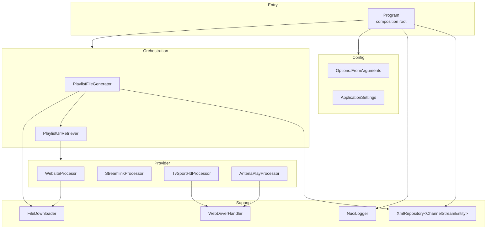

# Architecture

This document is a complementary elaboration of the root [ARCHITECTURE.md](../ARCHITECTURE.md).
The root document is the canonical architectural record; this file explains the layering and the
forces behind it in a form oriented to prospective modifications. It does not restate the root
document's tables.

## Style

StreamToM3U is a **layered console pipeline with a provider strategy**. There is exactly one
process, one composition root, and one execution path whose branching is decided at startup.

## Layering rules

| Layer | May depend on | Must not depend on |
|-------|---------------|--------------------|
| Entry (`Program`) | everything below | — |
| Configuration (`Configuration`) | nothing internal | service, processors, data access |
| Orchestration (`Service`, excluding processors) | configuration, models, data access, logging, processors | — |
| Processors (`Service/Processors`) | models, `WebDriverHandler`, `IFileDownloader` | `PlaylistFileGenerator`, `PlaylistUrlRetriever`, `Options`, file writing |
| Utilities (`Utils`) | nothing internal | service, configuration, data access |
| Data access (`DataAccess`) | `NuciDAL` | service models |
| Tests | application project | external services |

## The three decisions that shape everything

1. **Provider strategy chosen by enumeration switch.** Providers differ so much (regex over
   HTML, an external process, browser automation) that a common interface `IProcessor` plus a
   `switch` on `StreamProvider` is the whole dispatch mechanism. Adding a provider touches the
   enumeration, the switch, the CLI alias list, and the XML values. See
   [components/processors.md](./components/processors.md).

2. **One shared static browser handle with a spin lock.** Browser sessions are expensive and
   the automation stack is not thread safe, so all browser-driven providers serialize through
   `WebDriverHandler`. See [components/browser-automation.md](./components/browser-automation.md)
   and [concurrency-and-scheduling.md](./concurrency-and-scheduling.md).

3. **Silent failure with a successful exit.** A single unavailable channel must not abort a
   batch, so processor and download exceptions are swallowed and translated to `null`, which is
   then filtered out of the output. See [error-handling.md](./error-handling.md).

## Runtime shapes

There are exactly two run shapes, selected by the presence of `--input`:

| Shape | Trigger | Output |
|-------|---------|--------|
| Single stream | No `--input` | One URL on standard output |
| Batch | `--input <path>` | Merged file or per-channel directory |

Both shapes share the same resolution stage (`PlaylistUrlRetriever`) and the same providers.
See [flows/](./flows/).

## Dependency direction

Dependencies point inward: `Program` → `Service` → `Processors`. Configuration, logging, and
models are leaf areas. Data-access objects never reach processors; they are mapped to
`ChannelStream` in `Service/Mapping` first. The application project never references the test
project. Full inventory: [dependencies.md](./dependencies.md).

## Related documentation

- [design-decisions.md](./design-decisions.md) — rationale for each architectural choice.
- [invariants.md](./invariants.md) — properties that must remain true.
- [flows/startup-and-composition.md](./flows/startup-and-composition.md) — the startup sequence.
