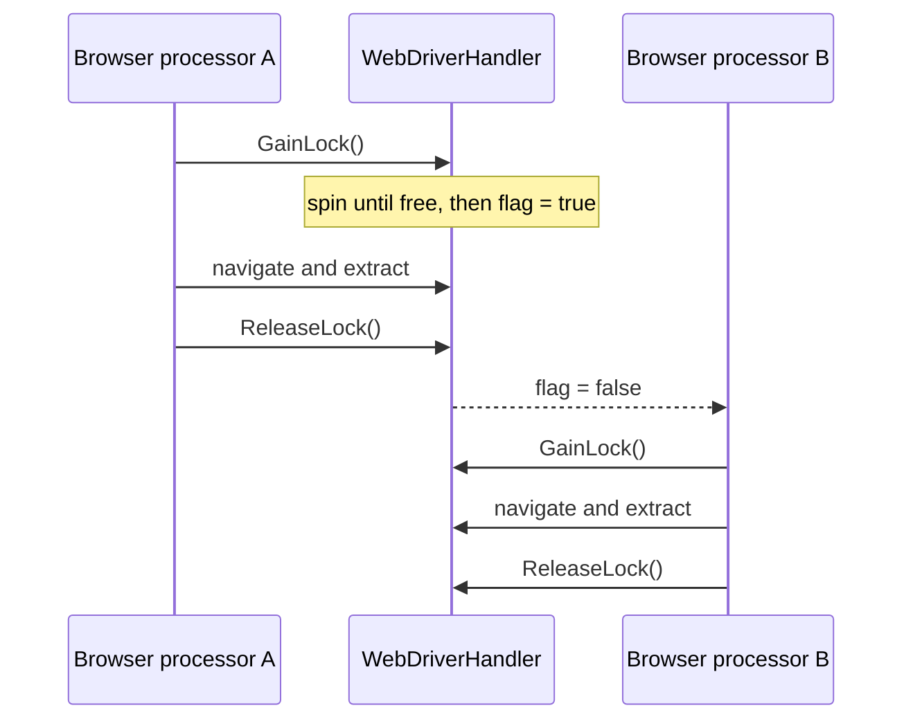

# Component: browser automation

Source: `StreamToM3U/Utils/WebDriverHandler.cs` →
`StreamToM3U.Utils.WebDriverHandler`, plus the NuciWeb automation abstractions used by the
browser-driven processors.

## Purpose

Own the single process-wide browser instance and serialise access to it.

## Scope

- Lazy creation of exactly one headless `ChromeDriver`.
- Chrome options and driver-service configuration.
- A cooperative lock used to serialise browser-driven providers.
- Driver shutdown.

## Boundary — what it does not own

- Page interaction logic (owned by the processors, through `IWebProcessor`).
- Configuration (the handler reads no settings; its options are constants).
- Any knowledge of providers, services, or data access.

## Static state

| Member | Type | Purpose |
|--------|------|---------|
| `webDriver` | `IWebDriver` | The single driver instance |
| `sync` | `Lock` | Guards lazy creation |
| `IsWebDriverLocked` | `bool` (public getter) | The cooperative lock flag |

## Members

| Member | Behaviour |
|--------|-----------|
| `WebDriver` (get) | Under `lock (sync)`, `webDriver ??= CreateDriver()`, then returns it |
| `CloseDriver()` | `webDriver?.Quit()`; leaves `webDriver` non-null |
| `GainLock()` | Under `lock (sync)`, spins with `Thread.Sleep(1000)` until `IsWebDriverLocked` is false, then sets it true |
| `ReleaseLock()` | Sets `IsWebDriverLocked = false` outside any lock |
| `CreateDriver()` (private) | Builds `ChromeOptions` and a `ChromeDriverService`, constructs `ChromeDriver`, maximizes the window |

## Chrome configuration

| Setting | Value |
|---------|-------|
| `PageLoadStrategy` | `None` (navigation returns before the page is fully loaded; processors rely on explicit element waits) |
| Arguments | `--silent`, `--disable-translate`, `--disable-infobars`, `--disable-extensions`, `--disable-notifications`, `--disable-application-cache`, `--headless`, `--disable-gpu`, `--window-size=1920,1080`, `--start-maximized`, `--blink-settings=imagesEnabled=false` |
| `ChromeDriverService` | `SuppressInitialDiagnosticInformation = true`, `HideCommandPromptWindow = true` |

The `--headless` and `--disable-gpu` arguments plus the disabled image loading make the browser
suitable for a server without a display.

## Lock semantics

**Hazards.**

- `GainLock` holds `lock (sync)` for the whole spin, so a second caller blocks on the monitor for
  up to a second per iteration rather than simply polling.
- `ReleaseLock` writes the flag outside the lock; the flag is not `volatile`, so release
  visibility is not guaranteed by the memory model.
- A processor that throws before releasing leaves the flag set forever for that process,
  blocking all subsequent browser-driven channels. This is the reason the processors' release
  calls are not in `finally` blocks.
- Because the driver is reused, `AntenaPlayProcessor`'s static `acceptedGdpr` flag ensures the
  consent banner is only handled once.

## Lifetime

The driver is created on first access to `WebDriver` and quit by
`Program.Main`'s `finally` block. If `CloseDriver` runs, the process exits with a browser
process terminated; if it does not (for example a hard crash), the Chrome process may survive.

## Tests

`WebDriverHandlerTests` (3 cases) exercises only the lock: free initially, taken after
`GainLock`, and freed after `ReleaseLock`. Driver creation itself is untested because it requires
Chrome.

## Related documentation

- [processors.md](./processors.md)
- [../concurrency-and-scheduling.md](../concurrency-and-scheduling.md)
- [../invariants.md](../invariants.md)
