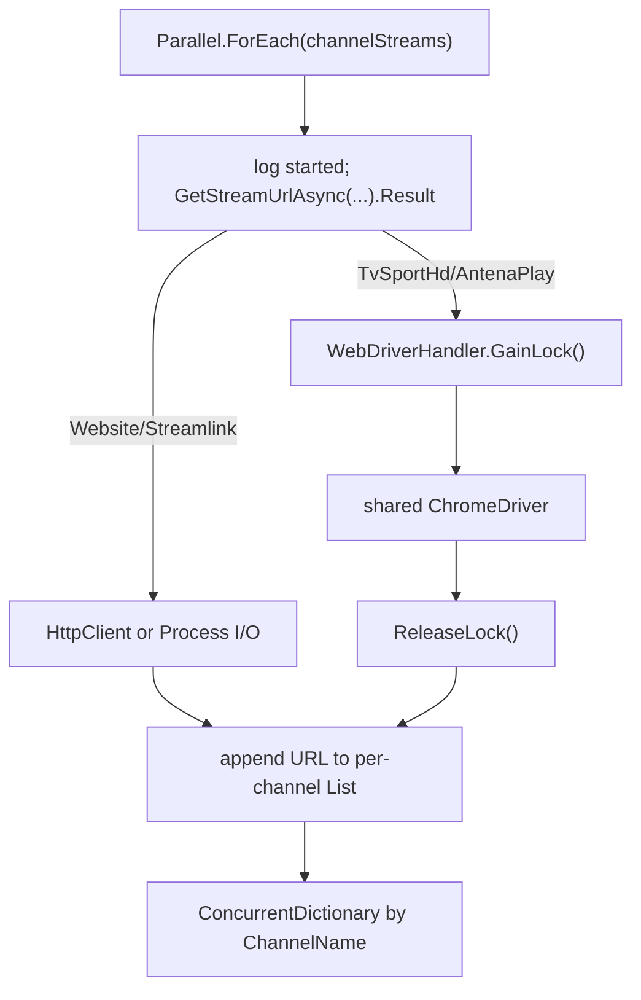

# Concurrency and scheduling

## Model

Batch resolution uses `Parallel.ForEach` over the channel collection. Inside each iteration, the
asynchronous resolution is awaited synchronously through `.Result`. There is no `async` entry
point and no `SynchronizationContext` handling.

## Parallelism characteristics

| Aspect | Behaviour |
|--------|-----------|
| Degree of parallelism | Unbounded; determined by the thread pool |
| Kind | Thread-blocking over I/O, not true asynchrony |
| Ordering | Output order is deterministic (ordered by channel name); stream order within a channel depends on completion order |
| Exception shape | `AggregateException` wrapping the original failures |

## Shared state and its guards

| Shared state | Guard | Assessment |
|--------------|-------|------------|
| Result dictionary | `ConcurrentDictionary` | Correct for dictionary operations |
| `ContainsKey` then `TryAdd` | None beyond the dictionary | Benign for this key set: only one empty list is added per distinct key |
| Per-channel `List<string>` | None | **Unsafe.** Concurrent `Add` on the same list can lose entries or corrupt the list when two XML entries share a `ChannelName` |
| `ChromeDriver` | Spin lock | Serialises browser providers, but the release path is fragile |

## The browser lock

`WebDriverHandler.GainLock` spins with a one-second `Thread.Sleep` while holding the monitor;
`ReleaseLock` sets the flag outside any lock. Consequences:

- Browser-driven channels are strictly sequential.
- A processor that throws before releasing the flag leaves it set, blocking all later
  browser-driven channels for the remainder of the process. Neither `TvSportHdProcessor` nor
  `AntenaPlayProcessor` releases in a `finally` block.
- Because failures inside the parallel body surface as `AggregateException` only at the end of
  `GeneratePlaylist`, a stalled lock can make a run appear to hang rather than fail.

## Synchronisation of writes

Playlist writing happens after the parallel loop completes, on the calling thread, from the
already-aggregated dictionary. There is no concurrent write to the filesystem from resolution
threads.

## Scheduling

The application contains no scheduler, timer, or daemon. Cadence is imposed externally. The
documented pattern is a systemd timer (`OnBootSec=3min`, `OnUnitActiveSec=40min`) invoking a
per-channel-set service instance. Runs are independent: no incremental reuse, no delta detection,
and no conditional regeneration. See [build-and-deployment.md](./build-and-deployment.md).

## Resource use

- `HttpClient` is a single reused instance, so sockets are pooled.
- One `ChromeDriver` per process, created lazily on first browser provider use.
- Merged mode adds one HTTP round-trip per surviving URL for the reachability probe.
- The README's systemd template suggests `MemoryMax=256M`, which covers the .NET footprint but
  not a simultaneous Chromium process.

## Related documentation

- [flows/batch-playlist-generation.md](./flows/batch-playlist-generation.md)
- [components/browser-automation.md](./components/browser-automation.md)
- [error-handling.md](./error-handling.md)
