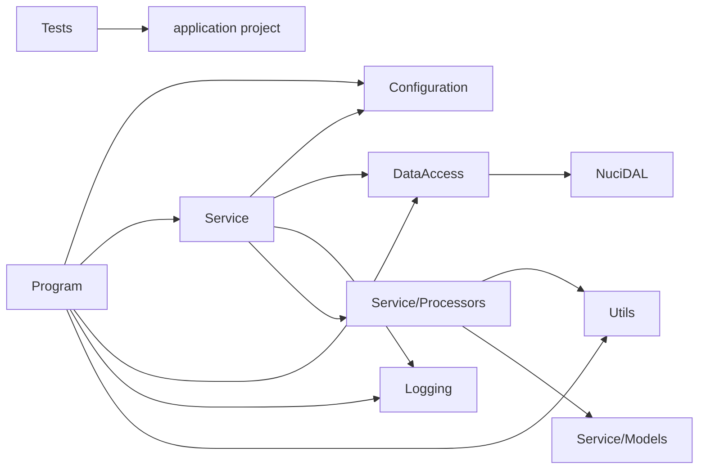

# Dependencies

## Application packages

Declared in `StreamToM3U/StreamToM3U.csproj`.

| Package | Version | Kind | Purpose in this repository |
|---------|---------|------|----------------------------|
| `Microsoft.Extensions.Configuration` | 11.0.0 | Framework | Configuration access |
| `Microsoft.Extensions.Configuration.Binder` | 11.0.0 | Framework | `config.Bind(sectionName, object)` |
| `Microsoft.Extensions.Configuration.FileExtensions` | 11.0.0 | Framework | `AddJsonFile` file provider |
| `Microsoft.Extensions.Configuration.Json` | 11.0.0 | Framework | JSON configuration source |
| `Microsoft.Extensions.DependencyInjection` | 11.0.0 | Framework | `ServiceCollection` composition root |
| `NuciCLI` | 3.0.4 | Internal | Shared command-line helpers |
| `NuciDAL` | 4.3.1 | Internal | `IRepository<T>`, `XmlRepository<T>`, `EntityBase` |
| `NuciExtensions` | 6.0.3 | Internal | `RemoveDiacritics`, `RemovePunctuation`, `ToSentenceCase`, `GetRandomElement` |
| `NuciLog` | 1.2.4 | Internal | `NuciLogger`, `NuciLoggerSettings` |
| `NuciLog.Core` | 3.1.2 | Internal | `ILogger`, `Operation`, `OperationStatus`, `LogInfo`, `LogInfoKey` |
| `NuciWeb` | 4.1.0 | Internal | `IWebProcessor`, `Select` |
| `NuciWeb.Automation` | 1.0.1 | Internal | Browser automation abstractions |
| `NuciWeb.Automation.Selenium` | 1.0.3 | Internal | `SeleniumWebProcessor` implementation |

`Selenium.WebDriver` and `OpenQA.Selenium` types (`ChromeDriver`, `ChromeOptions`,
`ChromeDriverService`, `IWebElement`, `By`, `PageLoadStrategy`) are consumed directly and arrive
transitively through `NuciWeb.Automation.Selenium`.

## Test packages

Declared in `StreamToM3U.ArchitectureTests/StreamToM3U.ArchitectureTests.csproj`.

| Package | Purpose |
|---------|---------|
| `Microsoft.CodeAnalysis.CSharp` | Roslyn syntax analysis over the staged sources |
| `Microsoft.NET.Test.Sdk` | Test host |
| `NUnit` | Test framework |
| `NUnit3TestAdapter` | Adapter for the test host |
| `TngTech.ArchUnitNET` | Compiled dependency rules |
| `TngTech.ArchUnitNET.NUnit` | NUnit integration for ArchUnit.NET |

Declared in `StreamToM3U.UnitTests/StreamToM3U.UnitTests.csproj`.

| Package | Version | Purpose |
|---------|---------|---------|
| `Microsoft.NET.Test.Sdk` | 18.12.0 | Test host |
| `Moq` | 4.21.0 | Doubles for `IFileDownloader`, `IPlaylistUrlRetriever`, `IRepository<T>`, `ILogger` |
| `NUnit` | 5.0.0 | Test framework |
| `NUnit.Analyzers` | 4.15.0 | Test-quality analyzers |
| `NUnit3TestAdapter` | 6.3.1 | Adapter for the test host |

The test projects reference the application project, and the application project never
references a test project. The architecture test project references only the application project,
so every dependency assertion is measured against production code alone.

## External process and service dependencies

| Dependency | Resolved by | Required for | Failure mode |
|------------|-------------|--------------|--------------|
| Chrome or Chromium | Selenium `ChromeDriver` | `TvSportHd`, `AntenaPlay` | Driver creation throws; resolution fails for the channel |
| ChromeDriver | `ChromeDriverService.CreateDefaultService()` (Selenium Manager) | `TvSportHd`, `AntenaPlay` | Same as above |
| `streamlink` executable | `Process.Start` with `FileName = "streamlink"` | `Streamlink` | `Win32Exception` surfaces as `AggregateException` in batch mode |
| Channel websites and CDNs | `HttpClient`, browser | `Website`, `TvSportHd`, `AntenaPlay` and playlist validation | `FileDownloader` returns `null`; resolution fails for the channel |
| TVSportHD site (`http://www.tv-sport-hd.com`) | Browser | `TvSportHd` | DOM mismatch → failed resolution |
| AntenaPlay site (`https://antenaplay.ro`) | Browser | `AntenaPlay` | Registration or stream pattern mismatch → failed resolution |

## Internal dependency graph

## Version pinning notes

- Every Nuci package is exactly pinned, so a dependency update is a deliberate change and should
  refresh [documentation-maintenance.md](./documentation-maintenance.md) considerations and the
  README dependency table.
- The release workflow derives the .NET version from `<TargetFramework>` in
  `StreamToM3U/StreamToM3U.csproj`, so changing that value changes the release toolchain too. See
  [build-and-deployment.md](./build-and-deployment.md).
