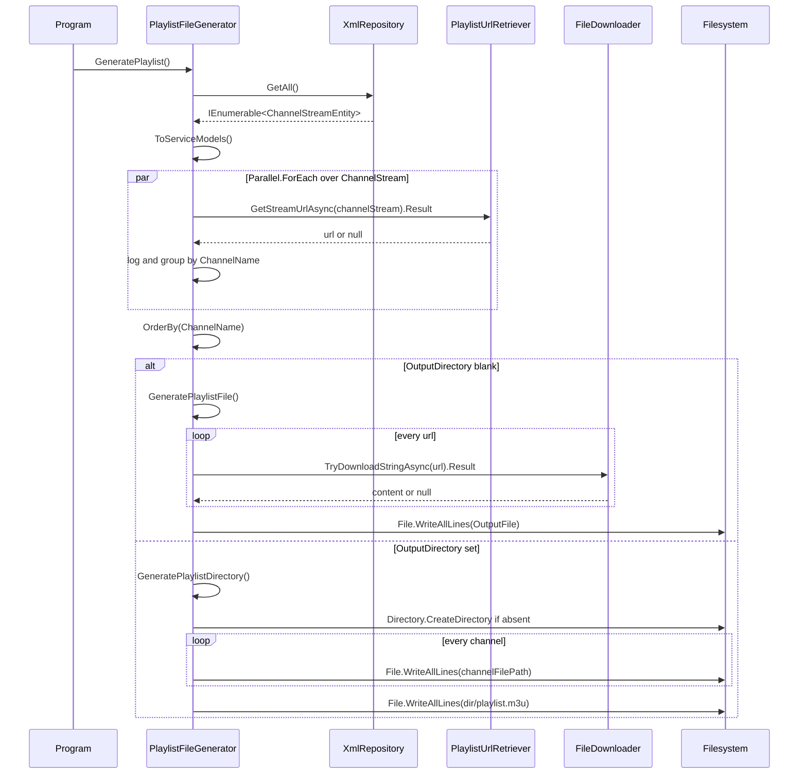

# Flow: batch playlist generation

Covers `PlaylistFileGenerator.GeneratePlaylist` and the two writers it delegates to.

## Sequence

## Step detail

1. **Load and map.** `channelStreamRepository.GetAll()` returns the XML entities, which
   `ToServiceModels()` maps to `ChannelStream`, parsing the provider with
   `Enum.Parse<StreamProvider>(value, true)`. A value that does not parse throws here, inside the
   parallel enumeration set-up, and therefore inside the parallel body.

2. **Parallel resolution.** Each channel logs `ChannelStreamFetching` at `Info`/`Started`, then
   resolves. Success logs `Debug`/`Success` and appends the URL to the list stored under the
   channel name; failure logs `Debug`/`Failure`.

3. **Aggregation.** The `ConcurrentDictionary<string, List<string>>` is projected into a
   `Dictionary` ordered by `OrderBy(x => x.Key)` on the channel name.

4. **Mode selection.** A whitespace or absent `OutputDirectory` selects merged mode.

5. **Writing.**
   - **Merged:** each URL is probed with a download; empty results are dropped; then
     `File.WriteAllLines(options.OutputFile, lines)`.
   - **Directory:** the directory is created if absent; per channel, the file name is derived and
     an `#EXTM3U` channel file written, and an index entry added; finally the index is written to
     `<dir>/playlist.m3u`.

## Ordering and grouping

- `ChannelName` is the grouping identity; `Id` is used only in log records.
- Ordering is by channel name through `OrderBy` (culture-sensitive default comparer).
- Within a channel, URLs appear in the order the parallel tasks completed, which is not
  deterministic for channels backed by multiple entries.

## Failure propagations

| Failure | Where it surfaces |
|---------|-------------------|
| Unparsable `Provider` | `AggregateException` out of `GeneratePlaylist`, logged per inner exception at `Fatal` |
| Provider returns `null` with validation required | `NullReferenceException` inside the parallel body → `AggregateException` |
| Missing `streamlink` executable | `Win32Exception` inside the parallel body → `AggregateException` |
| Output directory cannot be written | `IOException`/`UnauthorizedAccessException` out of `GeneratePlaylist` |

## Related documentation

- [../behaviour/generate-merged-playlist.md](../behaviour/generate-merged-playlist.md)
- [../behaviour/generate-playlist-directory.md](../behaviour/generate-playlist-directory.md)
- [../concurrency-and-scheduling.md](../concurrency-and-scheduling.md)
- [../error-handling.md](../error-handling.md)
