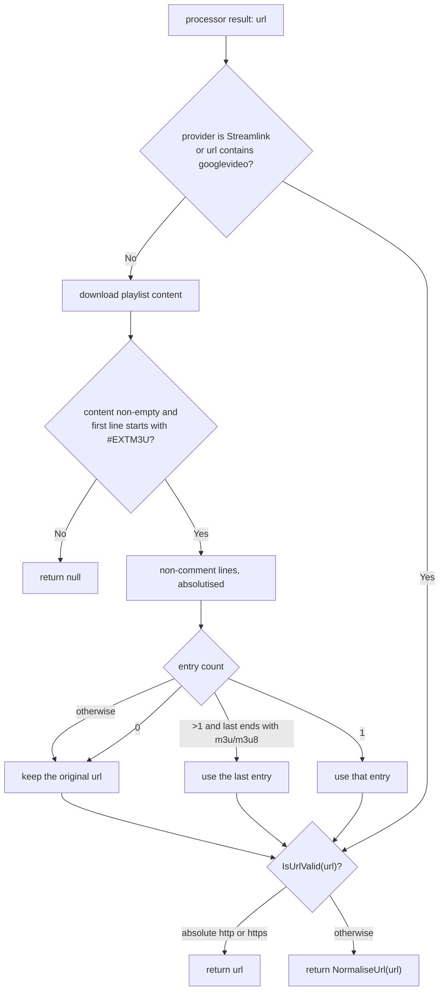

# Flow: playlist URL validation

Covers the validation and entry-selection logic inside
`PlaylistUrlRetriever.GetStreamUrlAsync`.

## Decision flow

## Step detail

1. **Bypass check.** `!provider.Equals(Streamlink) && !url.Contains("googlevideo")` gates
   validation. If the guard is unmet, the URL goes straight to the validity check.

2. **Download.** The URL is fetched through `IFileDownloader`. A `null`, empty, or whitespace
   body yields no lines.

3. **Header check.** The first line must start with `#EXTM3U`; otherwise the result is `null`.

4. **Entry collection.** Non-empty, non-`#` lines are transformed with `ProcessStreamUrl`:
   absolute (`http…`) entries are kept as-is; relative entries replace the trailing
   `[A-Za-z0-9_-]*\.m3u[8]*\?.*$` segment of the playlist URL via regex replacement.

5. **Selection.**
   - one entry → use it;
   - many entries and the last ends with `m3u`/`m3u8` → use the last;
   - otherwise → keep the original playlist URL.

6. **Validity and normalisation.** `IsUrlValid` requires a non-blank string that parses as an
   absolute URI with an `http` or `https` scheme. If invalid, `NormaliseUrl` is applied:
   URL-decode, replace `\/` with `/`, remove `#038;`.

## Worked examples

| Playlist content | Result |
|------------------|--------|
| `#EXTM3U\n` | The playlist URL |
| `#EXTM3U\nchunklist.m3u8\n` (relative) | The playlist URL with its last `*.m3u8` segment replaced by `chunklist.m3u8` |
| `#EXTM3U\nhttp://…/low.m3u8\nhttp://…/high.m3u8\n` | `http://…/high.m3u8` |
| `#EXTM3U\nhttp://…/high.m3u8\nhttp://…/segment.ts\n` | The playlist URL |
| `#EXTM3U\n#EXT-X-STREAM-INF:BANDWIDTH=873\n` | The playlist URL |
| `not a playlist` | `null` |

## Edge cases and hazards

- **`NullReferenceException`.** If validation is required and the processor returned `null`,
  `url.Contains` (in the guard) throws. This is pinned by
  `PlaylistUrlRetrieverTests.GivenANullPlaylistPage_WhenResolving_ThenANullReferenceExceptionIsThrown`
  and its siblings.
- **Escaped URLs.** `http:\/\/…#038;id=4` normalises to `http://…id=4`, which is intentional:
  the `#038;` marker is removed rather than decoded into `&`.
- **Regex replacement.** A relative entry replaces only the final `*.m3u[8]?` segment plus any
  query string. A playlist URL without such a trailing segment is left unchanged by the regex.

## Related documentation

- [single-stream-resolution.md](./single-stream-resolution.md)
- [../components/service-layer.md](../components/service-layer.md)
- [../data-model.md](../data-model.md)
