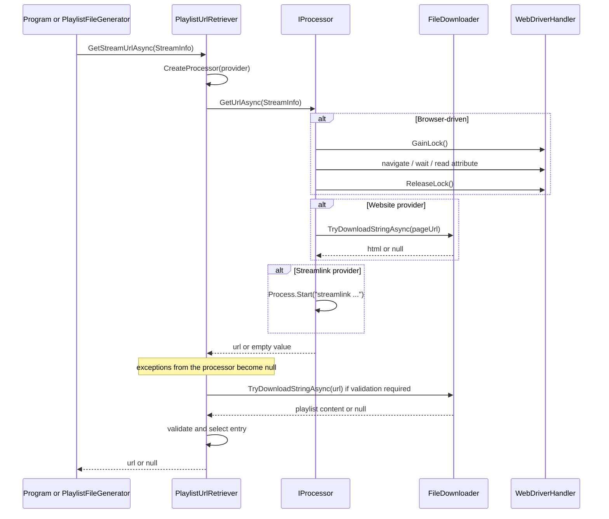

# Flow: single stream resolution

Covers `PlaylistUrlRetriever.GetStreamUrlAsync(StreamInfo)` — the one resolution path shared by
both modes.

## Sequence

## Step detail

1. **Processor selection.** `CreateProcessor(provider)` returns `TvSportHdProcessor`,
   `AntenaPlayProcessor`, `StreamlinkProcessor`, or `WebsiteProcessr` (the default arm).

2. **Processor invocation.** `FindStreamUrl` awaits `GetUrlAsync`, wrapping the call in
   `try/catch` that returns `null` for any exception. The dispatcher therefore never sees a
   provider failure as an exception.

3. **Validation guard.** Validation is skipped when `Provider == StreamProvider.Streamlink` or
   when the returned URL contains `googlevideo`.

4. **Validation.** When required:
   - the URL is downloaded;
   - the body must be non-empty and its first line must start with `#EXTM3U`, else `null`;
   - non-comment lines are collected and relativised against the playlist URL;
   - a single entry is selected, or the last entry if it ends in `m3u`/`m3u8` (see
     [playlist-url-validation.md](./playlist-url-validation.md)).

5. **Return.** If the URL is a valid absolute HTTP(S) URL it is returned unchanged; otherwise the
   normalised form (URL-decode, `\/` → `/`, remove `#038;`) is returned.

## Causal notes

- The validation guard explains why `Streamlink` results are returned essentially verbatim: the
  CLI already yields a playable URL, and downloading it could be expensive or rejected.
- `googlevideo` bypass exists because those URLs point directly at media segments, not at
  playlists that begin with `#EXTM3U`.
- Because processor exceptions become `null` and `null.Contains` throws, the documented
  `NullReferenceException` path occurs exactly when validation is required and a provider
  returns `null` — that is, for any non-Streamlink provider that fails during a page-based
  resolution. In batch mode this surfaces as `AggregateException`.

## Related documentation

- [playlist-url-validation.md](./playlist-url-validation.md)
- [batch-playlist-generation.md](./batch-playlist-generation.md)
- [../components/processors.md](../components/processors.md)
