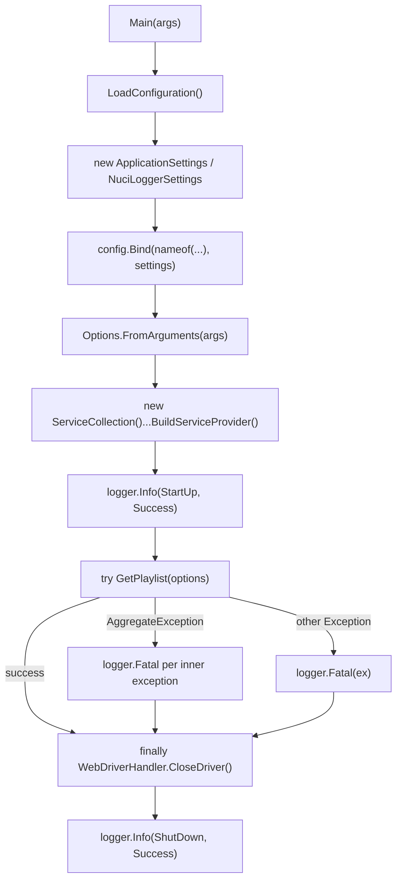

# Flow: startup and composition

Covers `Program.Main` from process entry to dispatch, and the shutdown that always follows.

## Sequence

## Step detail

1. **Load configuration.** `ConfigurationBuilder().AddJsonFile("appsettings.json", true, true)`
   — optional and reload-on-change. Failure to find the file is silent.

2. **Bind settings.** Two singletons are created and populated with `config.Bind(nameof(...), ...)`
   where the section name is the lower-camel-cased type name (`applicationSettings`,
   `nuciLoggerSettings`).

3. **Parse options.** `Options.FromArguments(args)` yields provider, input/output paths, and the
   channel parameters. Parsing never throws; unknown arguments are ignored.

4. **Build the container.** Registrations, in order:

   | Registration | Implementation |
   |--------------|----------------|
   | `ApplicationSettings` | instance |
   | `NuciLoggerSettings` | instance |
   | `Options` | instance |
   | `IFileRepository<ChannelStreamEntity>` | `new XmlRepository<ChannelStreamEntity>(options.InputFile)` |
   | `IFileDownloader` | `FileDownloader` |
   | `IPlaylistUrlRetriever` | `PlaylistUrlRetriever` |
   | `IPlaylistFileGenerator` | `PlaylistFileGenerator` |
   | `ILogger` | `NuciLogger` |

   All are singletons; there is no scope and no per-request creation. `IPlaylistUrlRetriever` and
   the processors are constructed by the container or directly; processor instances are created
   per resolution call inside `PlaylistUrlRetriever.CreateProcessor`.

   Note that the repository is constructed with `options.InputFile` even in single-stream mode,
   where it is unused.

5. **Log startup.** `logger.Info(Operation.StartUp, OperationStatus.Success)`.

6. **Dispatch.** `GetPlaylist(options)` selects single-stream or batch mode by
   `string.IsNullOrWhiteSpace(options.InputFile)`.

7. **Error handling.** `AggregateException` is unwrapped and each inner exception logged at
   `Fatal`; any other exception is logged once. Nothing is rethrown and the exit code is not
   changed.

8. **Shutdown.** `WebDriverHandler.CloseDriver()` quits the driver if one was created, regardless
   of success. Then `logger.Info(Operation.ShutDown, OperationStatus.Success)`.

## Ordering concerns

- `ApplicationSettings` must be bound before the container is built, because `FileDownloader`
  reads the timeout and user agent in its constructor.
- `Options` must exist before the repository is constructed, because its path is the constructor
  argument.
- `WebDriverHandler.CloseDriver()` runs after the log's `StartUp` and before `ShutDown`, so a
  browser failure does not prevent the shutdown line.

## Related documentation

- [single-stream-resolution.md](./single-stream-resolution.md)
- [batch-playlist-generation.md](./batch-playlist-generation.md)
- [../components/entry-and-composition.md](../components/entry-and-composition.md)
