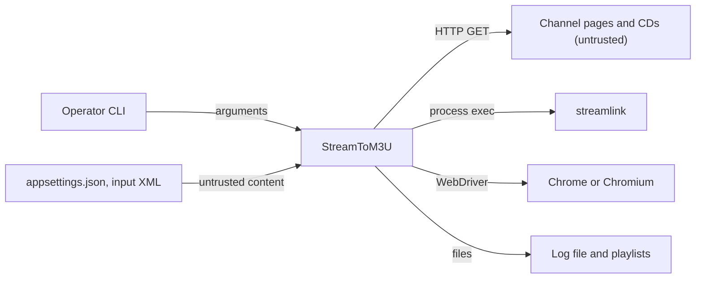

# Security

This document complements the root [SECURITY.md](../SECURITY.md). It records the trust model and
the surfaces a modification could weaken; it does not restate the reporting policy.

## Trust model

| Aspect | Position |
|--------|----------|
| Inbound network surface | None — no socket, no endpoint, no IPC |
| Authentication | None |
| Stored credentials | None |
| Secrets in configuration | None |
| Console privileges | Whatever the operator grants; the tool writes only operator-named paths |
| Telemetry | None |

## Trust boundaries

Treat as **untrusted**: channel page HTML, playlist bodies, stream URLs, browser page content, and
the XML input file (it may originate from a shared or fetched source).

## Threat surfaces and current mitigation

| Surface | Risk | Current handling |
|---------|------|------------------|
| HTML extraction | Malformed or hostile HTML misdirects extraction | Regex extraction; extracted URLs are validated as absolute HTTP(S) before use |
| Playlist body | A body that is not a playlist could misdirect output | First line must be `#EXTM3U`; the URL is revalidated |
| Stream URL writing | Arbitrary URL text written to playlists | URLs must parse as absolute HTTP(S) unless already validated |
| Channel file naming | Names derived from input could escape the output directory | Diacritics, punctuation, and spaces are stripped, but there is **no allow-list**; a crafted name could still produce unusual file names |
| Downloaded content | Executing untrusted content | Content is never executed; it is read as text only |
| `streamlink` invocation | Argument injection through the URL | The URL is appended to the argument string without quoting; a URL containing shell metacharacters would be an issue only if a shell were involved (`UseShellExecute = false`, so it is not) |
| Browser automation | Navigating to untrusted pages | The driver is sandboxed by Chrome defaults; image loading and extensions are disabled |
| AntenaPlay registration | Generated credentials sent to a third party | Values are random and ephemeral; no real identity is involved |
| Log file | Disclosure of resolved URLs and tokens | The log is treated as sensitive and is never transmitted; the README and PRIVACY.md advise restricting permissions |
| Release pipeline | Remote script execution | The release workflow pipes a remotely fetched script into `bash`; the README warns reviewers to inspect it |
| Dependencies | Malicious or vulnerable packages | All packages are version-pinned in the `.csproj` files and can be verified against the lock file |

## Out of scope

Channel pages, playlist documents, the Streamlink executable, Chrome/Chromium/ChromeDriver/
Selenium, third-party provider accounts, and forks. See the root
[SECURITY.md](../SECURITY.md) for the authoritative scope statement.

## Hardening opportunities

Recorded for future work, not as current behaviour:

- Path sanitisation for channel file names (an allow-list rather than removal-only).
- Log redaction of query strings in download URLs.
- Bounded parallelism for outbound requests.

See [ambiguities-and-open-questions.md](./ambiguities-and-open-questions.md).

## Related documentation

- [../SECURITY.md](../SECURITY.md)
- [../PRIVACY.md](../PRIVACY.md)
- [integrations.md](./integrations.md)
- [logging.md](./logging.md)
